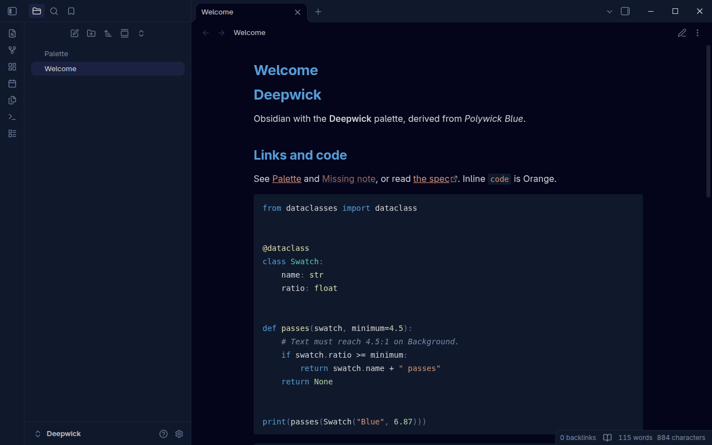

# Deepwick for Obsidian

Deep navy colors for [Obsidian](https://obsidian.md): the app, notes in reading
view and Live Preview, code blocks, callouts, tags and the graph view.

> Deepwick is an unofficial theme derived from
> [Polywick Blue](https://vscode.polywickstudio.net) by Polywick Studio (MIT).
> Not affiliated with Polywick Studio.



## Install

Copy the theme into your vault's themes folder (replace `path/to/vault`):

```sh
vault=path/to/vault
mkdir -p "$vault/.obsidian/themes/Deepwick"
cp theme.css manifest.json "$vault/.obsidian/themes/Deepwick"
```

Then open **Settings → Appearance**, choose **Deepwick** under Themes, and set
**Base color scheme** to **Dark**.

To uninstall, choose another theme and delete the `Deepwick` folder.

## Notes

- Dark only. With the light base color scheme, Obsidian shows its default light
  colors.
- Headings are Blue and bold. Links and inline code are Orange, tags are Teal,
  block quotes are Comment *italic*, and `==highlights==` use Selection.
- Deepwick sets the accent color directly (Blue), so the **Accent color**
  setting has little effect.
- Obsidian tints callout backgrounds and borders with partial opacity, and it
  draws unresolved links at reduced opacity. Those pixels are blends of
  palette colors.
- Faint text (placeholders, hints) is Muted, which is 4.02:1 on the Surface
  sidebars.
- Engine limitations: Obsidian has one keyword color, and its code grammars
  don't mark control flow. So `if`, `for`, `return` and `import` are Blue, not
  Magenta. In reading view (Prism), booleans and Python `None` share the number
  color (Sage), and Python `print` is a keyword (Blue). Live Preview's Python
  highlighting (CodeMirror legacy modes) colors class names like function
  names (Yellow), calls like variables (Light Blue), and `None` like a keyword
  (Blue).

Tested with Obsidian 1.14.4 on Linux.

## License

MIT. See [LICENSE](LICENSE).
